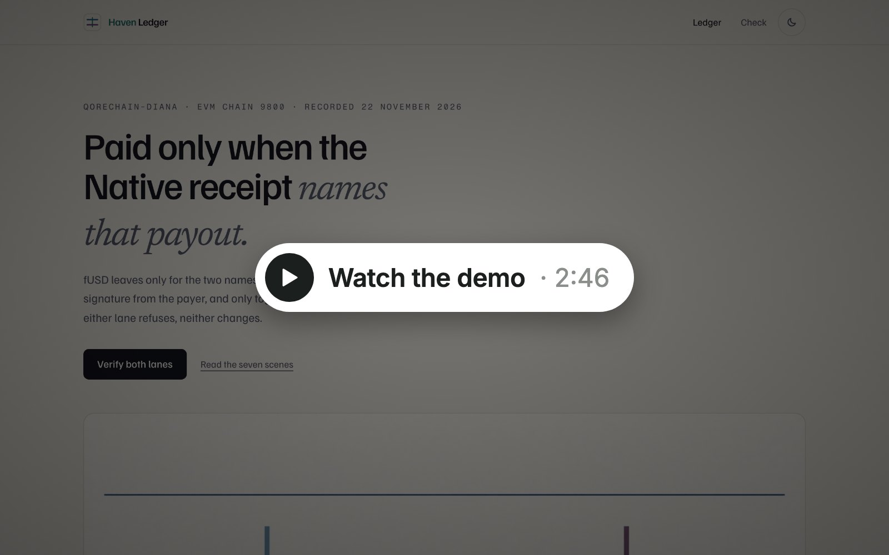
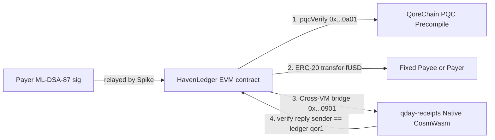

# Haven Ledger

**A payer pays a contractor or grantee in fUSD on QoreChain's EVM side; an auditor or a Cosmos-side app reads the payment trail on the Native side. Haven Ledger keeps the two from ever disagreeing: every payout writes its receipt into the governance-approved Native CosmWasm contract `qday-receipts` in the same EVM call, and if either lane refuses, neither changes.**

The reader on the Native side does not have to trust the payer, the relayer, or an indexer. A receipt whose `sender` is the ledger's own derived `qor1` address matches a real payout, and every payout has exactly one such receipt. fUSD leaves the ledger only for the payee or the payer named at creation, only with a fresh ML-DSA-87 signature from the payer, and no third recipient can ever be named.

**Two ledgers, one rule.** The original `HavenLedger` pays fUSD (an EVM ERC-20). A second contract, `HavenLedgerQor`, pays native QOR. QOR is the chain's bank coin (`uqor`), so its payouts change **two Native facts in the same transaction**: the payee's x/bank balance and the `qday-receipts` receipt. On 23 November 2026 a 1 QOR payout raised the payee's Native bank balance by exactly 1,000,000 uqor at height 10611180 together with receipt #11, and a failing payout undid a receipt that had already been written (see [QOR ledger evidence](#evidence-qor-ledger-23-november-2026)).

A payer funds a ledger with 1.000000 fUSD. When the payer signs a 0.100000 fUSD payout, the EVM transfer and Native receipt #4 land together in the same block — and when a note exceeds `qday-receipts`'s 140-character Native limit or the balance is short (5.00 against 0.90), both lanes roll back together and 0.000000 fUSD moves.

[Demo video (2:46)](https://drive.google.com/file/d/1YuR6Qxvw3hu0RyfVZHXfCtITZ4FG69k4/view) · [Live demo](https://haven-ledger-nine.vercel.app) · [Judge in 5 minutes](#judge-it-in-5-minutes) · [Run locally](#run-locally) · [What works today](#what-works-today)

<p align="center">
  <a href="https://drive.google.com/file/d/1YuR6Qxvw3hu0RyfVZHXfCtITZ4FG69k4/view"></a>
  <br />
  <sub><a href="https://drive.google.com/file/d/1YuR6Qxvw3hu0RyfVZHXfCtITZ4FG69k4/view">▶ Watch demo (2:46)</a></sub>
</p>

| Tested on QoreChain Diana (22 Nov 2026) | Result |
| --- | --- |
| Pay 100,000 fUSD base units to payee (Scene 1) | EVM transfer and Native receipt #4 landed atomically ([details](#evidence-deploy-fund-and-all-seven-scenes-22-november-2026)) |
| **Native** rejection (>140-char note, refused by `qday-receipts` itself) | The Native refusal reverted the whole EVM call, signature nonce included: tx status `0x0`, receipt count unchanged, 0 fUSD moved (Scene 2, `0xe30358d2…`) |
| **EVM** rejection (5,000,000 vs. 900,000 balance) | The Native receipt had **already been written** when the fUSD transfer failed; the chain undid it: tx status `0x0`, receipt count unchanged, 0 fUSD moved (Scene 3, `0x5fa5d1bc…`) |
| Junk signature or replayed Scene 1 signature | Both reverted `SignatureInvalid`; receipt count unchanged, 0 fUSD moved |
| Refund 200,000 fUSD base units to payer (Scene 6) | EVM refund and Native receipt #5 landed atomically ([details](#evidence-deploy-fund-and-all-seven-scenes-22-november-2026)) |

Why not separate EVM and Native transactions? Two separate transactions can split: money leaves on EVM without a Native receipt, or a receipt is written for a payout that reverted. Haven Ledger calls `qday-receipts` through QoreChain's Cross-VM bridge precompile (`0x…0901`) inside the same EVM call, so atomic rollback is enforced by the chain itself.

What does the Native side get that a log would not? A guarantee in both directions that the chain enforces, and authorship nobody can fake: only the ledger's bytecode can write as its `qor1` address, and it writes only inside a signed payout. In the fUSD ledger value moves on the EVM lane and the Native lane carries the record; in the QOR ledger the payee's Native bank balance moves in the same transaction as the receipt. See [Why Cross-VM, not a log](#why-cross-vm-not-a-log).

What is the biggest risk? Anyone can write directly to `qday-receipts` (on 23 November 2026, 10 of its 12 receipts came from other senders), so a reader that skips checking the receipt's `sender` can be fooled by a fake receipt. The web verifier and `npm run reconcile` apply that check through one tested helper, `verifyLedgerReceipt` (`src/ts/receipt.ts`), and `/verify` shows a spoofed receipt being rejected; a third-party reader that skips the check is still exposed. In addition, the Cross-VM bridge and `qday-receipts` exist on Diana testnet only.

How can a judge try it right now? Open [haven-ledger-nine.vercel.app/verify](https://haven-ledger-nine.vercel.app/verify) and click Verify both lanes to inspect the 7 fUSD scenes and 6 QOR scenes across EVM, Native CosmWasm and the Native bank live with no wallet, or clone the repo and run `npm run evidence` (47 checks, 0 keys).

---

## Contents

1. [The problem](#the-problem)
2. [How it works](#how-it-works)
3. [Why Cross-VM, not a log](#why-cross-vm-not-a-log)
4. [Hardest technical decision](#hardest-technical-decision)
5. [Judge it in 5 minutes](#judge-it-in-5-minutes)
6. [Where each attack or failure stops](#where-each-attack-or-failure-stops)
7. [Rubric and track mapping](#rubric-and-track-mapping)
8. [What works today](#what-works-today)
9. [Known limits](#known-limits)
10. [Run locally](#run-locally)
11. [Repository map](#repository-map)
12. [Roadmap](#roadmap)
13. [Built during the hackathon](#built-during-the-hackathon)
14. [AI disclosure](#ai-disclosure)
15. [Evidence: testnet addresses](#evidence-testnet-addresses)
16. [Evidence: deploy, fund, and all seven scenes (22 November 2026)](#evidence-deploy-fund-and-all-seven-scenes-22-november-2026)
17. [Evidence: QOR ledger (23 November 2026)](#evidence-qor-ledger-23-november-2026)
18. [Evidence: Foundry tests, fuzzing, and invariants](#evidence-foundry-tests-fuzzing-and-invariants)
19. [Evidence: design decisions and cost breakdown](#evidence-design-decisions-and-cost-breakdown)

---

## The problem

A payer pays a contractor from an EVM stablecoin balance. Someone else has to answer "was every payment recorded, and is every record a real payment?": an auditor, the grantee's accounting, or a Cosmos-side app that only reads Native state. When an EVM contract moves funds in one transaction and writes a Native audit receipt in another, the two lanes can drift apart: money leaves without a receipt if the second transaction fails, or a receipt is recorded for a payout that reverted.

Haven Ledger couples both actions into a single Cross-VM transaction while locking payouts to two fixed addresses under ML-DSA-87 authorization. If the ERC-20 transfer, the post-quantum signature check, or the Native `qday-receipts` write fails, neither lane changes.

---

## How it works



- Two fixed names, no admin: the constructor fixes `payer`, `payee`, `fUSD`, `qday-receipts`, and the ledger's own Bech32 `qor1` address (`src/Bech32.sol`). There is no owner, no upgrade, and no function that takes a recipient address.
- ML-DSA-87 authorization: `pay` and `refund` ignore `msg.sender` and verify the payer's fresh ML-DSA-87 signature over chain, contract, signer, action, nonce, deadline, amount, and memo via `PqAuth` (`haven-pq-kit`).
- Atomic Cross-VM call: inside the same transaction, `HavenLedger` transfers `fUSD`, calls `qday-receipts` through the bridge precompile (`0x0000000000000000000000000000000000000901`), and validates the strict JSON reply (`src/NativeReceipt.sol`), rejecting any reply with a mismatched sender, mismatched note, or unknown field.

---

## Why Cross-VM, not a log

### Rollback proven live, in both directions

Atomicity is the whole point of this track, and it is only proven when a call actually fails on testnet. Both failure directions were broadcast on QoreChain Diana on 22 November 2026, not only simulated in Foundry:

| What could go wrong | Live on testnet? | Evidence |
| --- | --- | --- |
| Native contract refuses the receipt | Yes: whole EVM call reverted (`status 0x0`), signature nonce undone, no transfer, no receipt | Scene 2, `0xe30358d24980be8452ba43259b3427f31365fda9b3412d1fcba738aa98e5c0ed` |
| EVM transfer fails **after** the Native receipt was written (the ledger writes the receipt first, then transfers) | Yes: the Native write was undone with it (`status 0x0`, receipt count stayed 4) | Scene 3, `0x5fa5d1bcab4e0fc6282fd9b823eae62c66bd64782708ea06869d04b41d087d4f` |
| Bad or replayed ML-DSA-87 signature | Yes: reverted `SignatureInvalid`, no Native write | Scenes 4 and 5 |
| Successful pay and refund write exactly one receipt each | Yes: receipts #4 and #5, sender = ledger `qor1` | Scenes 1 and 6; `npm run reconcile` matches 2/2 |
| Bridge target not on the allowlist | Refused in preflight only (not broadcast) | Scene 7 |

Every hash above is re-read by `npm run evidence` and by the [/verify](https://haven-ledger-nine.vercel.app/verify) page.

### What the Native side gets

The Native write is the part a Native-side reader relies on. What that reader gains, concretely:

- Both directions, enforced by the chain. Every `pay` or `refund` that moved fUSD has exactly one receipt from the ledger's `qor1` sender, and every receipt from that sender belongs to a payout that moved fUSD. Two separate transactions can promise at most one of these, and only with an off-chain retrier. Here a missing receipt and a receipt for a reverted payout are both impossible, because they are one call (Scenes 2 and 3 show the rollback live).
- Authorship nobody can fake. The receipt's `sender` is the ledger's own address in Bech32 (`Bech32.qor(address(this))`). It belongs to contract code, not to a key, so the payer, the payee, and the relayer (Spike) cannot write as it. The ledger writes as it only inside `pay` or `refund`, after the payer's ML-DSA-87 signature checks, and `NativeReceipt.sol` rejects any bridge reply that names another sender.
- Cross-references both ways. The Native note carries the payout number and a commitment over chain, ledger, action, recipient, token, amount, nonce, and signature hash. The EVM payout stores the Native receipt id and height. Either side can be checked from the other; `npm run reconcile` does that for every payout and every receipt.
- No EVM needed to read it. An indexer or another CosmWasm contract can query `qday-receipts` (`count`, `receipt`) and keep the rows whose `sender` is the ledger's `qor1` address. That filtered list is the payout list.

Honest limit: in the fUSD ledger, value moves on the EVM lane only (the ERC-20 transfer); the Native lane carries a record that cannot disagree with the payout. `HavenLedgerQor` closes part of that gap: QOR is the chain's bank coin, so its payout lands in the payee's Native x/bank balance in the same transaction as the receipt. It is still sent by an EVM contract (a value call), not by a Native contract. We checked what else is possible on Diana (23 November 2026, read-only): the bridge allowlist has four Native targets, and the only one that holds value is the `WDT` CW20 (`qor14hj2…93uuqt`), whose entire supply (1,000 WDT) sits in its creator's wallet; neither the community nor the organisers could provide any. The EVM exposes no bank or ERC-20-conversion precompile (only `0x…0901`, `0x…0C01`, `0x…0a01`, `0x…0a02`). So no contract can pay through a Native CosmWasm token transfer on this testnet today; paying in the bank coin itself is the closest available.

---

## Hardest technical decision

Leaving the 140-character note limit exclusively on the Native side instead of duplicating it in Solidity.

Adding a `memo.length <= 140` check in Solidity would have caught long notes before reaching the Cross-VM bridge, hiding whether a Native CosmWasm refusal actually rolls back an EVM token transfer. Letting `qday-receipts` enforce its own 140-character limit lets Scene 2 prove live on testnet that a Native-lane rejection atomically undoes the EVM payout and leaves the receipt count unchanged.

---

## Judge it in 5 minutes

Everything below runs on QoreChain Diana (`qorechain-diana`, EVM chain ID `9800`) using test fUSD. If the live testnet RPC is unreachable, `/verify` reports `"Could not reach the testnet"` rather than a false pass (see [Known limits](#known-limits)).

1. Browser cross-lane verification (no wallet, no setup): open [haven-ledger-nine.vercel.app/verify](https://haven-ledger-nine.vercel.app/verify) and click Verify both lanes to check all 7 scenes across EVM and Native CosmWasm live. Further down the same page, Verify the QOR ledger checks the QOR ledger's 6 scenes, including each payout's Native bank balance change.
2. One-command hash verification from a clone (no keys):
   ```bash
   git clone --recurse-submodules https://github.com/datharnu/haven-ledger
   cd haven-ledger
   npm ci
   npm run evidence
   ```
   On 23 November 2026 `npm run evidence` printed 47 passed, 0 failed (fUSD ledger plus the QOR ledger, including each QOR payout's Native bank balance change at its height).
3. Offline Foundry and TypeScript tests (no chain, no keys):
   ```bash
   forge build && forge test
   npm run typecheck && npm run test:ts
   ```
   Runs 67 Foundry tests (see [Evidence: Foundry tests, fuzzing, and invariants](#evidence-foundry-tests-fuzzing-and-invariants)) and 18 TypeScript tests; `cd apps/web && npm ci && npm run test:unit` runs 30 more for the web verifier.
4. Receipt ↔ payout reconciliation (read-only, no keys): `npm run reconcile` lists every `qday-receipts` receipt, keeps only those from the ledger's `qor1` address, and matches them both ways against `payout(i)` and the `Moved` events. It prints `2 matched, 0 mismatched, N receipts from other senders ignored` (29 on 24 November 2026; N grows as others use `qday-receipts`).

---

## Where each attack or failure stops

- Native contract rejects a note over 140 characters (Scene 2): `qday-receipts` refuses; the Cross-VM bridge reverts the EVM payout atomically.
- EVM transfer exceeds ledger balance (Scene 3): reverts `ERC20InsufficientBalance`; the Native receipt write rolls back with it.
- Junk signature (Scene 4): reverts `SignatureInvalid` before reaching the bridge.
- Replayed Scene 1 signature (Scene 5): reverts `SignatureInvalid` because the nonce has advanced.
- Unlisted Native bridge target (Scene 7): refused by the bridge before broadcast; no transaction hash is produced.
- Spoofed receipt written directly to `qday-receipts` by someone else: rejected by checking `receipt.sender == qor1fdhya5x2lxyecp7fjgk7kzu95fgyu6gcs40yzu` in `verifyLedgerReceipt` (`src/ts/receipt.ts`, used by `/verify` and `npm run reconcile`). `/verify` shows the check on every agreed scene and rejects a labeled example (the preflight receipt, sender Spike, simulated and never written). An exact copy of the ledger's note from another sender is rejected the same way (tested).
- Tampered bridge JSON reply (changed byte, wrong sender, wrong note, unknown field): rejected by `NativeReceipt.sol` and fuzzed across 256 runs.
- `pay` signature reused on `refund`: refused because the signed action domain differs.

---

## Rubric and track mapping

Built for Build Before Q-Day (`https://build.qorechain.io/`), category bounty Cross-VM ("Build an application where an EVM contract atomically calls an approved Native contract"). Deadline: 2 December 2026 at 23:59 UTC.

| Requirement (exact hackathon wording) | Where Haven Ledger proves it | Honest limit |
| --- | --- | --- |
| A working EVM-to-Native call to an approved Native contract | `HavenLedger` (fUSD) and `HavenLedgerQor` (native QOR) call governance-approved `qday-receipts` via bridge precompile `0x…0901` and verify the ledger's own `qor1` sender in the reply ([addresses](#evidence-testnet-addresses)). | Targets existing governance-approved `qday-receipts` rather than deploying a new Native contract (new Native contracts require governance). |
| Atomic execution shown on testnet | Scenes 1 and 6 land EVM transfers and Native receipts together; Scenes 2 and 3 prove rollback from both Native and EVM refusals ([all 7 scenes](#evidence-deploy-fund-and-all-seven-scenes-22-november-2026)). The QOR ledger repeats this with the payout landing in the payee's Native bank balance in the same transaction ([6 QOR scenes](#evidence-qor-ledger-23-november-2026)). | Scene 8 (window hiding the bridge) was skipped because `eth_call` cannot preview it and a live broadcast would have executed a valid payout. |
| Public GitHub repository under MIT or Apache-2.0 | `https://github.com/datharnu/haven-ledger`, Apache-2.0 (`LICENSE`). | Deployed bytecode is not verified against source on the explorer (`foundry.toml` has compiler settings). |
| README, testnet addresses, and video (up to 3 min) | This single-file `README.md` holds all addresses, hashes, and limits; shot list in `docs/DEMO.md`; cover in `docs/cover.png`. | [Demo video](https://drive.google.com/file/d/1YuR6Qxvw3hu0RyfVZHXfCtITZ4FG69k4/view) (2:46). Motion-graphics explainer built from the recorded evidence, with synthetic narration (ElevenLabs); not a screen recording of a live session. `docs/cover.png` not yet uploaded to the project page. |


### Where the PQC checks are (for jurors)

The two Solidity PQC items (`pqcVerify`, `pqcKeyStatus`) are checked by hand, so here is every call site.

| Contract | What the ML-DSA-87 check protects | Call site |
| --- | --- | --- |
| `HavenLedger` (fUSD) | Payer's key status at creation; every `pay`/`refund` needs the payer's fresh signature | [`src/HavenLedger.sol` L83](src/HavenLedger.sol#L83) → `PqAuth.init`; [L148](src/HavenLedger.sol#L148) → `PqAuth.authorize` |
| `HavenLedgerQor` (QOR) | Same, with its own signed actions | [`src/HavenLedgerQor.sol` L93](src/HavenLedgerQor.sol#L93); [L184](src/HavenLedgerQor.sol#L184) |

All ML-DSA-87 checks go through the vendored kit `haven-pq-kit` (git submodule `lib/haven-pq-kit`, pinned at `9fe7ac2`; GitHub shows submodules only as a link, so the lines are linked here):

- Precompile addresses: [`PqAuth.sol` L8–9](https://github.com/datharnu/haven-pq-kit/blob/9fe7ac289f512e39bce6a2d5e31baeb98195519c/src/PqAuth.sol#L8-L9) — `pqcVerify` `0x…0a01`, `pqcKeyStatus` `0x…0a02`.
- `pqcVerify` call: [`PqAuth.verify`, L75–84](https://github.com/datharnu/haven-pq-kit/blob/9fe7ac289f512e39bce6a2d5e31baeb98195519c/src/PqAuth.sol#L75-L84); `pqcKeyStatus` call: [`PqAuth._status`, L95–105](https://github.com/datharnu/haven-pq-kit/blob/9fe7ac289f512e39bce6a2d5e31baeb98195519c/src/PqAuth.sol#L95-L105), used by [`_loadKey`, L86](https://github.com/datharnu/haven-pq-kit/blob/9fe7ac289f512e39bce6a2d5e31baeb98195519c/src/PqAuth.sol#L86) (registered, ML-DSA-87, possession proven, 2,592-byte key; fails closed).
- Single-signer authorization (nonce, deadline, domain-separated message): [`PqAuth.authorize`, L45](https://github.com/datharnu/haven-pq-kit/blob/9fe7ac289f512e39bce6a2d5e31baeb98195519c/src/PqAuth.sol#L45).

**Shared deployer.** `spike` (`qor143f0ghn8slqguwez73087dvq8lqnuuukqdu9fl`) deploys and relays for all four Haven entries (Courier, Haven Escrow, Haven Ledger, Steward). Project-page badges proven by its transactions do not by themselves mean this project uses that feature; `docs/kits.md` and this README say what this project uses.

---

## What works today

### Observed

- Deployed and funded `HavenLedger` on `qorechain-diana` on 22 November 2026, and completed all 7 recorded scenes ([full hashes and final balances](#evidence-deploy-fund-and-all-seven-scenes-22-november-2026)).
- Automated checks passed on 22 November 2026: `npm run evidence` (47 passed, 0 failed, 23 Nov), `forge test` (67 passed, 0 failed, 23 Nov), and GitHub Actions run `45005303250` (contract job).
- `npm run reconcile` on 23 November 2026: `qday-receipts` held 7 receipts; receipts 4 and 5 came from the ledger and matched payouts 0 (pay 100,000) and 1 (refund 200,000) and their `Moved` events; receipts 1, 2, 3, 6, and 7 came from other senders and were set aside; 0 mismatches.
- Live browser verification at `https://haven-ledger-nine.vercel.app/verify` passed on 22 November 2026 at 390px and 1440px (7 checked, 2 agreed on both lanes, 4 refused, 1 no hash, 0 overflow, 0 RPC errors).

### Built, not observed

- CI web smoke job is configured in `.github/workflows/test.yml`; run `45005303250` ran the contract job only.
- The visible sender check and the spoofed-receipt example on `/verify` pass locally (unit tests, Playwright smoke at 390px and 1440px, and the live `/verify` test on 23 November 2026); they reach `haven-ledger-nine.vercel.app` only after the next deploy.

### Deliberately absent

- Scene 8 (window hiding the bridge): skipped intentionally to avoid broadcasting an unpreviewable valid payout.
- Integration with Haven Escrow or Steward: confirmed standalone; neither repo calls `HavenLedger`.
- Bytecode-vs-source check in the browser UI: covered locally by `forge test`.

---

## Known limits

- Anyone can write to `qday-receipts`: readers must check `receipt.sender == qor1fdhya5x2lxyecp7fjgk7kzu95fgyu6gcs40yzu`, or they can be fooled by an unrelated receipt. This repo's readers do (`verifyLedgerReceipt`); a third-party reader has to do the same. (The preflight `eth_call` in `deployments/preflight.json` returned a simulated receipt whose sender was Spike and wrote nothing; `/verify` shows it rejected.)
- `npm run reconcile` reads every receipt in the book one by one and scans `Moved` logs in 10,000-block steps, so it grows with the book and with chain height.
- Height equality is observed, not enforced: EVM block and Native height matched on Scenes 1 and 6, while `eth_call` preflight was one block ahead; the contract records both without asserting equality.
- Testnet only: Cross-VM bridge `0x…0901`, `qday-receipts`, and fUSD live on `qorechain-diana` only.
- No explorer source verification: compiler settings are in `foundry.toml`.

---

## Run locally

Prerequisites: Node 22 and Foundry (`forge`).

```bash
git clone --recurse-submodules https://github.com/datharnu/haven-ledger
cd haven-ledger
npm ci
forge build && forge test
npm run typecheck && npm run test:ts
npm run evidence      # re-checks all 47 recorded checks, fUSD and QOR ledgers (no keys)
npm run reconcile     # matches every receipt to a payout both ways, plus QOR bank changes (no keys)
```

Web app (`http://localhost:3000`):

```bash
cd apps/web
npm ci
npm run dev           # / is the record, /verify runs Verify both lanes
```

Do not re-run `npm run deploy`, `npm run fund-account`, `npm run fund-ledger`, or `npm run scenes` (finished reports throw `already ran`).

---

## Repository map

| Path | Responsibility |
| --- | --- |
| `src/HavenLedger.sol` | Immutable two-name ledger calling `PqAuth` (`0x…0a01`) and Cross-VM bridge (`0x…0901`) atomically |
| `src/NativeReceipt.sol` | Strict JSON parser and validator for `qday-receipts` bridge replies |
| `src/Bech32.sol` | On-chain derivation of the ledger's own `qor1` Bech32 address |
| `src/ts/` | TypeScript ML-DSA-87 signer, shared vectors, and `receipt.ts` (`verifyLedgerReceipt`, `reconcile`) |
| `apps/web/` | Next.js app (`/` record, `/verify` live dual-lane verifier with sender check and spoofed-receipt example at `https://haven-ledger-nine.vercel.app`); `lib/receipt.ts` is a tested copy of `src/ts/receipt.ts` |
| `scripts/` | Deploy, fund, 7 fUSD scenes; `deploy-qor.ts`, `fund-ledger-qor.ts`, `scenes-qor.ts` (6 QOR scenes, plan by default, `--broadcast` to send); `evidence.ts` (47 checks); `reconcile.ts` (read-only receipt ↔ payout ↔ bank match) |
| `deployments/` | Recorded testnet JSON hashes and preflight `eth_call` output |
| `test/` | 67 Foundry unit, fuzz, invariant, and vector tests (`HavenLedger` and `HavenLedgerQor`) |

---

## Roadmap

1. Before 2 December 2026: upload `docs/cover.png` to the project page. The [demo video](https://drive.google.com/file/d/1YuR6Qxvw3hu0RyfVZHXfCtITZ4FG69k4/view) (2:46) is done.
2. External audit: audit `HavenLedger.sol`, `NativeReceipt.sol`, and `Bech32.sol` before real-value use.
3. Mainnet: deploy on QoreChain mainnet once Cross-VM bridge `0x…0901` and a governance-approved receipt contract are live on mainnet.

---

## Built during the hackathon

Built during Build Before Q-Day (November 2026; deadline 2 December 2026 at 23:59 UTC). First commit: `62e1293` on 22 November 2026 (`Add the Apache-2.0 license.`). Licence: Apache-2.0 (`LICENSE`).

Credits: `@qorechain/sdk` 0.14.0, `@qorechain/evm` 0.14.0, `@qorechain/pqc` 0.2.3; `haven-pq-kit` v0.1.0 (`9fe7ac289f512e39bce6a2d5e31baeb98195519c`, interface following `qore-pq-kit` by Adityaakr, Apache-2.0); `forge-std` v1.17.0 (`f3dae6e6ee381f25eb6a246f7da9b85c91a68219`); Cross-VM call shape follows QoreChain's `workshop-3/02-cross-vm` ([build-before-qday](https://github.com/qorechain/build-before-qday)).

---

## AI disclosure

Commits `62e1293`, `4136809`, `c235e16`, `06f032b`, and `1773ea3` (22 Nov 2026) and initial docs were written in Cursor with Grok 4.7 under human direction; later README restructuring used Antigravity. The use-case opening, the Native-reader section, `verifyLedgerReceipt`, the spoofed-receipt example on `/verify`, `npm run reconcile`, and their tests were added on 23 November 2026 with Claude Code (Claude Opus) under human direction. Human decisions included the single atomic two-name rule, targeting governance-approved `qday-receipts`, keeping the 140-character limit on the Native side so Scene 2 proves Native rollback, using Spike as a zero-authority relayer, avoiding a Pool 2 swap, and skipping Scene 8.

The demo video (23 November 2026) was built in Remotion with Claude Code (Claude Opus 5.5) from this README's recorded evidence, and the human reviewed and approved every script. Its narration is a synthetic ElevenLabs voice; the background track is Mixkit's "Vastness".

---

## Evidence: testnet addresses

Network: `qorechain-diana` (EVM chain ID `9800`). Explorer: `https://explore.qore.network`.

| Role / Contract | Address |
| --- | --- |
| `HavenLedger` (fUSD) | `0x4B6E4ed0Caf9899c07c9922DEb0b85A2504E6918` / `qor1fdhya5x2lxyecp7fjgk7kzu95fgyu6gcs40yzu` |
| `HavenLedgerQor` (native QOR) | `0x087180B80f356AAFB772b091fa7CE5C03675919b` / `qor1ppccpwq0x442ldmjkzgl5l89cqm8tyvm3recw3` |
| Payer | `qor1fw43p6292ljewm7l2hxtu47jd8v66hmkyajz4q` / `0x4bAb10E94557E5976FDf55cCbe57D269d9Ad5f76` |
| Payee | `qor1yfs8uxwhq9ammnu5eeafk3r0387k94fs82n86g` / `0x22607e19d7017bBdCf94Ce7a9B446F89fD62d530` |
| fUSD (ERC-20, 6 decimals) | `0x97143B771D34ddb9130b807b135Ae675A5a963CA` |
| `qday-receipts` (Native CosmWasm) | `qor1xjayq5ev55tkzpml9klxwyshr7gdrha0nurha9jhm0f0gdckksgs3gltw8` |
| Spike (deployer & relayer, not a party) | `qor143f0ghn8slqguwez73087dvq8lqnuuukqdu9fl` / `0xaC52f45E6787c08E3B22f45e7f35803Fc13e7396` |

Payer setup: funded 3,000,000 uqor (`871100955616776AB80EE1E7D8749F1E9C36A530A962237464E1DB76CA081617`), enrolled ML-DSA-87 with proof of possession (`E8B758F28878BDC0CEE735B8685F8115D3FFBF8D4EF7BAE20D9830FEAA88EA33`). Payee needed no QOR and no key enrollment.

---

## Evidence: deploy, fund, and all seven scenes (22 November 2026)

Scene 1 moved 100,000 fUSD base units to the payee and wrote Native receipt #4 (`haven-ledger v1 n=0`) at height 10543960. Scenes 2, 3, 4, 5, and 7 each moved 0 fUSD base units and left the Native receipt count at 4. Scene 6 refunded 200,000 fUSD base units to the payer and wrote Native receipt #5 (`haven-ledger v1 n=1`) at height 10544236. Final state after all scenes: `nonce() == 2`, `payoutCount() == 2`, receipt count 5, balances 700,000 (ledger), 200,000 (payer), and 100,000 (payee).

### Deploy and fund

| Step | Hash | Gas | Fee |
| --- | --- | ---: | ---: |
| Open deploy window | `02DC8C4BEE87B449588CE57684AF72C2D45CEEF4C40B25D713B3B25C371DBD5C` | 187,340 | 180,000 uqor |
| Deploy `HavenLedger` | `0xe13ba27c1ef83f18c1e1afb237447d2075d2c23bf666022c31463ecd261edac4` | 1,988,176 | 223,670 uqor |
| Close deploy window | `7D932A024B35D3376F4414A74A9721CBCFA5A2F8AA4E846455BD96289197A3C8` | 170,532 | 180,000 uqor |
| Fund ledger (1,000,000 via `MsgConvertCoin`) | `9ECA49BBD47467966800637D55BD35440B4095292566B551BF13F78F7A33925F` | — | — |

### Seven scenes

| Scene | Outcome | EVM Hash | Gas / Fee |
| --- | --- | --- | --- |
| 1 | Pay 100,000 to payee; receipt #4 at height 10543960 (`count 3 → 4`); ledger 900,000, payee 100,000 | `0x915c5f80901db1c4097ca1d766a07e86876dd41bf9050a4b37f4a50593e468a3` | 889,125 / 100,027 uqor |
| 2 | Reverted (`the note must be 1 to 140 characters`); receipt count stayed 4 | `0xe30358d24980be8452ba43259b3427f31365fda9b3412d1fcba738aa98e5c0ed` | 1,000,000 / 112,500 uqor |
| 3 | Reverted `ERC20InsufficientBalance` (5,000,000 vs. 900,000); receipt count stayed 4 | `0x5fa5d1bcab4e0fc6282fd9b823eae62c66bd64782708ea06869d04b41d087d4f` | 1,000,000 / 112,500 uqor |
| 4 | Reverted `SignatureInvalid`; receipt count stayed 4 | `0x5db0afa49e3ec28c2359ca3c1a40b0ec5538ecdd54894f82b8f0c15cbd0fbfad` | 1,000,000 / 112,500 uqor |
| 5 | Replayed Scene 1 signature; reverted `SignatureInvalid`; receipt count stayed 4 | `0xc78e0efe3806c3d032fda2374551359246d0f1dadd936d0107a5f63dca2a4677` | 1,000,000 / 112,500 uqor |
| 6 | Refund 200,000 to payer; receipt #5 at height 10544236 (`n=1`, `count 4 → 5`); ledger 700,000, payer 200,000, nonce 2 | `0x78a95df330323747e9def24189446977a70869af091545ca6f4c420d34ec490d` | 846,143 / 95,192 uqor |
| 7 | Unlisted bridge target refused before broadcast | *(none)* | — |

### Window open and close hashes

| Scene | Open (`pqc`) | Close (`pqc`) |
| --- | --- | --- |
| 1 | `49702ECCEB160FC853B3A4670AD21A163AD5EFB38ABC9D48DDD819EF4BFFE88E` | `A507C54EA1333CF855CFF9C60904243BD2C44DD8B41A333801DC3C15416F8367` |
| 2 | `7ADC75F8D9679A1A15AF8E5E7418054E568DE533A37F3A2B480092EBF22397CC` | `CA2C9E56C6039E6043714C2345D27575F53622043E69FD27E39520007144CED6` |
| 3 | `270504DFFAFC14A9917FA43801A0B52368AAE5E68138134F2888C1A479449660` | `0AFC86419EA91A8904FDD505424DACD7E1F091144875DCF64FEB935B1AE0C896` |
| 4 | `3A576F94BE9118313367EA4AF27CFC192B45028284BCF8713CE77C91C85A1276` | `5E1C7179296D3BCEC267599E5E1D7C17FCAC215C2372DE4614D3EADFBF97D8B4` |
| 5 | `184EB0A55C657A5E70582EFF3F64F447FB3E37B47331EE7325755171ADBF28E6` | `DE59EFD85A564EF8F245081EFB0ADD3B0FC49146C81BB0AB6C4566EF2AAD0F19` |
| 6 | `CCBD041F1E83328F8D36D4D7BB24DFDA0C5190D9F133B4B3383E9A002D06DB9F` | `111AEA9F850A1B5A0DE4F0A61791458F059CE867AD5AFEEBFB7FD818E5829BF8` |

---

## Evidence: QOR ledger (23 November 2026)

`HavenLedgerQor` (`src/HavenLedgerQor.sol`) has the same two fixed names, payer ML-DSA-87 signature, and atomic `qday-receipts` write as `HavenLedger`, with its own signed actions (`haven-ledger.qor.pay` / `.refund`, token `address(0)`) so a signature for one ledger cannot be replayed on the other. Amounts must be whole uqor (multiples of 1e12 wei), so the bank balance moves by exactly the payout. Order inside the call: signature → Native receipt → store payout → send QOR; a short balance or a payee that refuses QOR undoes the receipt. The note adds ` a=<N>uqor` so a Native reader sees the amount.

### Deploy and fund

| Step | Hash | Gas | Fee |
| --- | --- | ---: | ---: |
| Open deploy window | `424B52E2AE3282130CBC2B95DC619A27D13149964B3DBE2DEA55E223C0F05AF1` | 187,401 | 180,000 uqor |
| Deploy `HavenLedgerQor` | `0xf26aac931240f1b1d2890bf19e33fcd5f37f26c4778294fc515204dc27bbcffe` | 2,001,374 | 225,155 uqor |
| Close deploy window | `7B82EF7607CF7D182B2029E432F67F92C63D7C23DC98327F718ED4581697EF0E` | 170,593 | 180,000 uqor |
| Fund 5 QOR (bank `MsgSend` from payer to the ledger's `qor1`) | `E6FC9770ED1B5EDC8345DAE292815C4BB4D3CD2390CB09F8CCB8B4B8BCC1A9D8` | — | 180,000 uqor |

After funding, the ledger's bank balance was 5,000,000 uqor and its EVM balance 5×10¹⁸ wei: one balance, two views.

### Six scenes

| Scene | Outcome | Native bank (account, height: before → after) | EVM hash |
| --- | --- | --- | --- |
| 1 | Pay 1 QOR to payee; receipt #11 (`count 10 → 11`) | payee, 10611180: 0 → **1,000,000 uqor** | `0xc41d45e30ce0cd081351aaefe6b50a494c40fd1b2a38b7cc44cbf88c0af0aa3e` |
| 2 | Note too long for `qday-receipts`; Native refusal reverted the whole call; count stayed 11 | payee, 10611209: unchanged | `0x78d7e94ca52f2bdbb647907f3e31699bd79426dd8c37bea2f3b83b372c52d5ec` |
| 3 | Pay 10 QOR while the ledger held 4: `InsufficientBalance` **after** the Native receipt was written; the receipt was undone; count stayed 11 | payee, 10611229: unchanged | `0x73bc77241f860c4d809f9318085a756b181108b8f06b530a3070951fb23c2532` |
| 4 | Junk signature: `SignatureInvalid`; count stayed 11 | payee, 10611243: unchanged | `0xaadc1aa080648f969b263917449727d75b4c3d633e76d0b55cff12bc0fe132f9` |
| 5 | Replay of scene 1's signature: `SignatureInvalid`; count stayed 11 | payee, 10611257: unchanged | `0xb2b5fb42b3401c58f698d109eb4b01ccffe5d83790be9a7933144efcda360a77` |
| 6 | Refund 2 QOR to payer; receipt #12 (`count 11 → 12`) | payer, 10611272: 82,370,000 → **84,370,000 uqor** | `0xfaf94ebef57f91fda050b954c6437739e344696167b7cc5c68dd6c18554e7433` |

`npm run reconcile` matches both QOR payouts to receipts #11 and #12 and to the bank changes above (2 matched, 0 mismatched). The bank check compares the balance after block H−1 with after block H, so it equals the payout only if nothing else touched that account in the same block; the payee holds nothing else, and the scripts report "offline" rather than pass if a node has pruned the height.

---

## Evidence: Foundry tests, fuzzing, and invariants

On 23 November 2026 `forge test` printed 67 passed, 0 failed, across 7 suites. Forge counts each invariant suite as one test; each suite checks two invariants, all listed as `[PASS]`. The `.gas-snapshot` of 22 November recorded the first 32, before the `HavenLedgerQor` suites were added.

`HavenLedger` (32, as recorded on 22 November):

- 26 unit tests (`test/HavenLedger.t.sol`): Bech32 derivation, constructor guards, atomic pay/refund, Native refusal rollback, EVM transfer refusal rollback, strict reply validation, replay/wrong-signer/expired-deadline refusals; plus 1 byte-vector test (`VectorsTest`).
- 4 fuzz tests (256 runs each): `testFuzz_pay_aNoteOverTheNativeLimitMovesNothing`, `testFuzz_pay_anyFundedAmountWritesOneReceiptAndPaysThePayee`, `testFuzz_pay_anyOtherSignatureIsRefused`, `testFuzz_reply_rejectsAnyChangedByte`.
- 1 invariant suite with 2 invariants (64 runs, 2,560 calls each, 0 reverts): `invariant_fundsGoOnlyToPayerOrPayee`, `invariant_onePayoutPerNativeReceipt`.

`HavenLedgerQor` (35, added 23 November):

- 30 unit tests (`test/HavenLedgerQor.t.sol`).
- 4 fuzz tests (256 runs each): `testFuzz_pay_aNoteOverTheNativeLimitMovesNothing`, `testFuzz_pay_anAmountThatIsNotWholeUqorIsRefused`, `testFuzz_pay_anyOtherSignatureIsRefused`, `testFuzz_pay_anyWholeUqorAmountWritesOneReceiptAndPaysThePayeeExactly`.
- 1 invariant suite with 2 invariants: `invariant_qorGoesOnlyToPayerOrPayee`, `invariant_onePayoutPerNativeReceipt`.

---

## Evidence: design decisions and cost breakdown

| Decision | Why |
| --- | --- |
| Use governance-approved `qday-receipts` | New Native contracts require governance; `qday-receipts` is live on Diana today |
| Keep 140-char check on Native side only | Lets Scene 2 prove live on testnet that a Native refusal rolls back the EVM payout |
| Verify `receipt.sender == ledger qor1` | Prevents spoofing by anyone writing directly to `qday-receipts` |
| Zero-authority relayer | Spike submits payer-signed calls without being payer or payee |

Measured costs on `qorechain-diana` (protocol fee: 0):

- Deploy `HavenLedger`: 1,988,176 gas (223,670 uqor) + 360,000 uqor window open/close.
- Atomic `pay` (Scene 1): 889,125 gas (100,027 uqor) + 360,000 uqor window open/close.
- Atomic `refund` (Scene 6): 846,143 gas (95,192 uqor) + 360,000 uqor window open/close.
- Reverted calls (Scenes 2–5): 1,000,000 gas (112,500 uqor) + 360,000 uqor window open/close.
