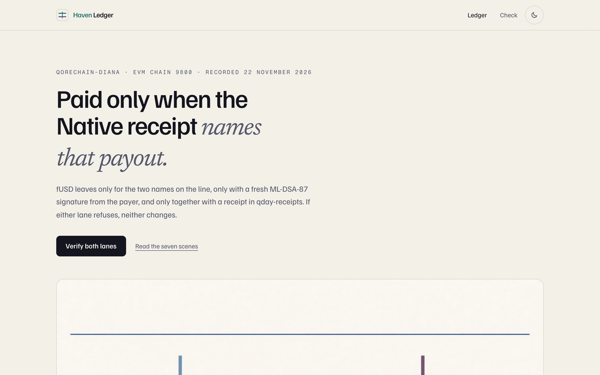
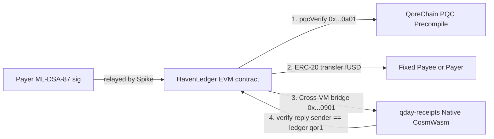

# Haven Ledger

**fUSD leaves the ledger only for the payee or the payer named at creation, only with a fresh ML-DSA-87 signature from the payer, and only together with a receipt in `qday-receipts`. If either lane refuses, neither changes.**

Built for QoreChain applications that need EVM stablecoin payouts strictly coupled to a governance-approved Native CosmWasm receipt (`qday-receipts`). The payer and payee are fixed at creation, every payout requires a fresh ML-DSA-87 signature from the payer, and no third recipient can ever be named.

A payer funds a ledger with 1.000000 fUSD. When the payer signs a 0.100000 fUSD payout, the EVM transfer and Native receipt #4 land together in the same block — and when a note exceeds `qday-receipts`'s 140-character Native limit or the balance is short (5.00 against 0.90), both lanes roll back together and 0.000000 fUSD moves.

[Live demo](https://haven-ledger-nine.vercel.app) · [Watch the film (up to 3 min — not recorded yet)](#built-during-the-hackathon) · [Judge in 5 minutes](#judge-it-in-5-minutes) · [Run locally](#run-locally) · [What works today](#what-works-today)

<p align="center">
  <a href="https://haven-ledger-nine.vercel.app"></a>
</p>

| Tested on QoreChain Diana (22 Nov 2026) | Result |
| --- | --- |
| Pay 100,000 fUSD base units to payee (Scene 1) | EVM transfer and Native receipt #4 landed atomically ([details](#evidence-deploy-fund-and-all-seven-scenes-22-november-2026)) |
| Native rejection (>140-char note) or EVM rejection (5,000,000 vs. 900,000) | Both reverted atomically; receipt count unchanged, 0 fUSD moved |
| Junk signature or replayed Scene 1 signature | Both reverted `SignatureInvalid`; receipt count unchanged, 0 fUSD moved |
| Refund 200,000 fUSD base units to payer (Scene 6) | EVM refund and Native receipt #5 landed atomically ([details](#evidence-deploy-fund-and-all-seven-scenes-22-november-2026)) |

Why not separate EVM and Native transactions? Two separate transactions can split: money leaves on EVM without a Native receipt, or a receipt is written for a payout that reverted. Haven Ledger calls `qday-receipts` through QoreChain's Cross-VM bridge precompile (`0x…0901`) inside the same EVM call, so atomic rollback is enforced by the chain itself.

What is the biggest risk? Anyone can write directly to `qday-receipts`, so a verifier that skips checking the Native receipt's `sender` (the ledger's own derived `qor1` address) can be spoofed by a fake receipt. In addition, the Cross-VM bridge and `qday-receipts` exist on Diana testnet only.

How can a judge try it right now? Open [haven-ledger-nine.vercel.app/verify](https://haven-ledger-nine.vercel.app/verify) and click Verify both lanes to inspect all 7 scenes across EVM and Native CosmWasm live with no wallet, or clone the repo and run `npm run evidence` (25 checks, 0 keys).

---

## Contents

1. [The problem](#the-problem)
2. [How it works](#how-it-works)
3. [Hardest technical decision](#hardest-technical-decision)
4. [Judge it in 5 minutes](#judge-it-in-5-minutes)
5. [Where each attack or failure stops](#where-each-attack-or-failure-stops)
6. [Rubric and track mapping](#rubric-and-track-mapping)
7. [What works today](#what-works-today)
8. [Known limits](#known-limits)
9. [Run locally](#run-locally)
10. [Repository map](#repository-map)
11. [Roadmap](#roadmap)
12. [Built during the hackathon](#built-during-the-hackathon)
13. [AI disclosure](#ai-disclosure)
14. [Evidence: testnet addresses](#evidence-testnet-addresses)
15. [Evidence: deploy, fund, and all seven scenes (22 November 2026)](#evidence-deploy-fund-and-all-seven-scenes-22-november-2026)
16. [Evidence: Foundry tests, fuzzing, and invariants](#evidence-foundry-tests-fuzzing-and-invariants)
17. [Evidence: design decisions and cost breakdown](#evidence-design-decisions-and-cost-breakdown)

---

## The problem

When an EVM contract moves funds in one transaction and writes a Native audit receipt in another, the two lanes can drift apart: money leaves without a receipt if the second transaction fails, or a receipt is recorded for a payout that reverted.

Haven Ledger couples both actions into a single Cross-VM transaction while locking payouts to two fixed addresses under ML-DSA-87 authorization. If the ERC-20 transfer, the post-quantum signature check, or the Native `qday-receipts` write fails, neither lane changes.

---

## How it works



- Two fixed names, no admin: the constructor fixes `payer`, `payee`, `fUSD`, `qday-receipts`, and the ledger's own Bech32 `qor1` address (`src/Bech32.sol`). There is no owner, no upgrade, and no function that takes a recipient address.
- ML-DSA-87 authorization: `pay` and `refund` ignore `msg.sender` and verify the payer's fresh ML-DSA-87 signature over chain, contract, signer, action, nonce, deadline, amount, and memo via `PqAuth` (`haven-pq-kit`).
- Atomic Cross-VM call: inside the same transaction, `HavenLedger` transfers `fUSD`, calls `qday-receipts` through the bridge precompile (`0x0000000000000000000000000000000000000901`), and validates the strict JSON reply (`src/NativeReceipt.sol`), rejecting any reply with a mismatched sender, mismatched note, or unknown field.

---

## Hardest technical decision

Leaving the 140-character note limit exclusively on the Native side instead of duplicating it in Solidity.

Adding a `memo.length <= 140` check in Solidity would have caught long notes before reaching the Cross-VM bridge, hiding whether a Native CosmWasm refusal actually rolls back an EVM token transfer. Letting `qday-receipts` enforce its own 140-character limit lets Scene 2 prove live on testnet that a Native-lane rejection atomically undoes the EVM payout and leaves the receipt count unchanged.

---

## Judge it in 5 minutes

Everything below runs on QoreChain Diana (`qorechain-diana`, EVM chain ID `9800`) using test fUSD. If the live testnet RPC is unreachable, `/verify` reports `"Could not reach the testnet"` rather than a false pass (see [Known limits](#known-limits)).

1. Browser cross-lane verification (no wallet, no setup): open [haven-ledger-nine.vercel.app/verify](https://haven-ledger-nine.vercel.app/verify) and click Verify both lanes to check all 7 scenes across EVM and Native CosmWasm live.
2. One-command hash verification from a clone (no keys):
   ```bash
   git clone --recurse-submodules https://github.com/datharnu/haven-ledger
   cd haven-ledger
   npm ci
   npm run evidence
   ```
   On 22 November 2026 `npm run evidence` printed 25 passed, 0 failed.
3. Offline Foundry and TypeScript tests (no chain, no keys):
   ```bash
   forge build && forge test
   npm run typecheck && npm run test:ts
   ```
   Runs 32 Foundry tests (see [Evidence: Foundry tests, fuzzing, and invariants](#evidence-foundry-tests-fuzzing-and-invariants)).

---

## Where each attack or failure stops

- Native contract rejects a note over 140 characters (Scene 2): `qday-receipts` refuses; the Cross-VM bridge reverts the EVM payout atomically.
- EVM transfer exceeds ledger balance (Scene 3): reverts `ERC20InsufficientBalance`; the Native receipt write rolls back with it.
- Junk signature (Scene 4): reverts `SignatureInvalid` before reaching the bridge.
- Replayed Scene 1 signature (Scene 5): reverts `SignatureInvalid` because the nonce has advanced.
- Unlisted Native bridge target (Scene 7): refused by the bridge before broadcast; no transaction hash is produced.
- Spoofed receipt written directly to `qday-receipts` by someone else: rejected by checking `receipt.sender == qor1fdhya5x2lxyecp7fjgk7kzu95fgyu6gcs40yzu`.
- Tampered bridge JSON reply (changed byte, wrong sender, wrong note, unknown field): rejected by `NativeReceipt.sol` and fuzzed across 256 runs.
- `pay` signature reused on `refund`: refused because the signed action domain differs.

---

## Rubric and track mapping

Built for Build Before Q-Day (`https://build.qorechain.io/`), category bounty Cross-VM ("Build an application where an EVM contract atomically calls an approved Native contract"). Deadline: 2 December 2026 at 23:59 UTC.

| Requirement (exact hackathon wording) | Where Haven Ledger proves it | Honest limit |
| --- | --- | --- |
| A working EVM-to-Native call to an approved Native contract | `HavenLedger` calls governance-approved `qday-receipts` via bridge precompile `0x…0901` and verifies the ledger's own `qor1` sender in the reply ([addresses](#evidence-testnet-addresses)). | Targets existing governance-approved `qday-receipts` rather than deploying a new Native contract (new Native contracts require governance). |
| Atomic execution shown on testnet | Scenes 1 and 6 land EVM transfers and Native receipts together; Scenes 2 and 3 prove rollback from both Native and EVM refusals ([all 7 scenes](#evidence-deploy-fund-and-all-seven-scenes-22-november-2026)). | Scene 8 (window hiding the bridge) was skipped because `eth_call` cannot preview it and a live broadcast would have executed a valid payout. |
| Public GitHub repository under MIT or Apache-2.0 | `https://github.com/datharnu/haven-ledger`, Apache-2.0 (`LICENSE`). | Deployed bytecode is not verified against source on the explorer (`foundry.toml` has compiler settings). |
| README, testnet addresses, and video (up to 3 min) | This single-file `README.md` holds all addresses, hashes, and limits; shot list in `docs/DEMO.md`; cover in `docs/cover.png`. | Film not recorded yet; `docs/cover.png` not yet uploaded to the project page. |

---

## What works today

### Observed

- Deployed and funded `HavenLedger` on `qorechain-diana` on 22 November 2026, and completed all 7 recorded scenes ([full hashes and final balances](#evidence-deploy-fund-and-all-seven-scenes-22-november-2026)).
- Automated checks passed on 22 November 2026: `npm run evidence` (25 passed, 0 failed), `forge test` (32 passed, 0 failed), and GitHub Actions run `45005303250` (contract job).
- Live browser verification at `https://haven-ledger-nine.vercel.app/verify` passed on 22 November 2026 at 390px and 1440px (7 checked, 2 agreed on both lanes, 4 refused, 1 no hash, 0 overflow, 0 RPC errors).

### Built, not observed

- CI web smoke job is configured in `.github/workflows/test.yml`; run `45005303250` ran the contract job only.

### Deliberately absent

- Scene 8 (window hiding the bridge): skipped intentionally to avoid broadcasting an unpreviewable valid payout.
- Integration with Haven Escrow or Steward: confirmed standalone; neither repo calls `HavenLedger`.
- Bytecode-vs-source check in the browser UI: covered locally by `forge test`.

---

## Known limits

- Anyone can write to `qday-receipts`: off-chain verifiers must check `receipt.sender == qor1fdhya5x2lxyecp7fjgk7kzu95fgyu6gcs40yzu`, or they can be fooled by an unrelated receipt. (The preflight `eth_call` in `deployments/preflight.json` returned a simulated receipt whose sender was Spike and wrote nothing.)
- Height equality is observed, not enforced: EVM block and Native height matched on Scenes 1 and 6, while `eth_call` preflight was one block ahead; the contract records both without asserting equality.
- Testnet only: Cross-VM bridge `0x…0901`, `qday-receipts`, and fUSD live on `qorechain-diana` only.
- No explorer source verification: compiler settings are in `foundry.toml`.

---

## Run locally

Prerequisites: Node 22 and Foundry (`forge`).

```bash
git clone --recurse-submodules https://github.com/datharnu/haven-ledger
cd haven-ledger
npm ci
forge build && forge test
npm run typecheck && npm run test:ts
npm run evidence      # re-checks all 25 recorded testnet hashes (no keys)
```

Web app (`http://localhost:3000`):

```bash
cd apps/web
npm ci
npm run dev           # / is the record, /verify runs Verify both lanes
```

Do not re-run `npm run deploy`, `npm run fund-account`, `npm run fund-ledger`, or `npm run scenes` (finished reports throw `already ran`).

---

## Repository map

| Path | Responsibility |
| --- | --- |
| `src/HavenLedger.sol` | Immutable two-name ledger calling `PqAuth` (`0x…0a01`) and Cross-VM bridge (`0x…0901`) atomically |
| `src/NativeReceipt.sol` | Strict JSON parser and validator for `qday-receipts` bridge replies |
| `src/Bech32.sol` | On-chain derivation of the ledger's own `qor1` Bech32 address |
| `src/ts/` | TypeScript ML-DSA-87 signer and shared vectors |
| `apps/web/` | Next.js app (`/` record, `/verify` live dual-lane verifier at `https://haven-ledger-nine.vercel.app`) |
| `scripts/` | Deploy, fund, 7 scenes, and `evidence.ts` (25 checks) |
| `deployments/` | Recorded testnet JSON hashes and preflight `eth_call` output |
| `test/` | 32 Foundry unit, fuzz, invariant, and vector tests |

---

## Roadmap

1. Before 2 December 2026: record and publish the ≤3-minute demo film (`docs/DEMO.md`) and upload `docs/cover.png` to the project page.
2. External audit: audit `HavenLedger.sol`, `NativeReceipt.sol`, and `Bech32.sol` before real-value use.
3. Mainnet: deploy on QoreChain mainnet once Cross-VM bridge `0x…0901` and a governance-approved receipt contract are live on mainnet.

---

## Built during the hackathon

Built during Build Before Q-Day (November 2026; deadline 2 December 2026 at 23:59 UTC). First commit: `62e1293` on 22 November 2026 (`Add the Apache-2.0 license.`). Licence: Apache-2.0 (`LICENSE`).

Credits: `@qorechain/sdk` 0.14.0, `@qorechain/evm` 0.14.0, `@qorechain/pqc` 0.2.3; `haven-pq-kit` v0.1.0 (`9fe7ac289f512e39bce6a2d5e31baeb98195519c`, interface following `qore-pq-kit` by Adityaakr, Apache-2.0); `forge-std` v1.17.0 (`f3dae6e6ee381f25eb6a246f7da9b85c91a68219`); Cross-VM call shape follows QoreChain's `workshop-3/02-cross-vm` ([build-before-qday](https://github.com/qorechain/build-before-qday)).

---

## AI disclosure

Commits `62e1293`, `4136809`, `c235e16`, `06f032b`, and `1773ea3` (22 Nov 2026) and initial docs were written in Cursor with Grok 4.7 under human direction; later README restructuring used Antigravity. Human decisions included the single atomic two-name rule, targeting governance-approved `qday-receipts`, keeping the 140-character limit on the Native side so Scene 2 proves Native rollback, using Spike as a zero-authority relayer, avoiding a Pool 2 swap, and skipping Scene 8.

---

## Evidence: testnet addresses

Network: `qorechain-diana` (EVM chain ID `9800`). Explorer: `https://explore.qore.network`.

| Role / Contract | Address |
| --- | --- |
| `HavenLedger` | `0x4B6E4ed0Caf9899c07c9922DEb0b85A2504E6918` / `qor1fdhya5x2lxyecp7fjgk7kzu95fgyu6gcs40yzu` |
| Payer | `qor1fw43p6292ljewm7l2hxtu47jd8v66hmkyajz4q` / `0x4bAb10E94557E5976FDf55cCbe57D269d9Ad5f76` |
| Payee | `qor1yfs8uxwhq9ammnu5eeafk3r0387k94fs82n86g` / `0x22607e19d7017bBdCf94Ce7a9B446F89fD62d530` |
| fUSD (ERC-20, 6 decimals) | `0x97143B771D34ddb9130b807b135Ae675A5a963CA` |
| `qday-receipts` (Native CosmWasm) | `qor1xjayq5ev55tkzpml9klxwyshr7gdrha0nurha9jhm0f0gdckksgs3gltw8` |
| Spike (deployer & relayer, not a party) | `qor143f0ghn8slqguwez73087dvq8lqnuuukqdu9fl` / `0xaC52f45E6787c08E3B22f45e7f35803Fc13e7396` |

Payer setup: funded 3,000,000 uqor (`871100955616776AB80EE1E7D8749F1E9C36A530A962237464E1DB76CA081617`), enrolled ML-DSA-87 with proof of possession (`E8B758F28878BDC0CEE735B8685F8115D3FFBF8D4EF7BAE20D9830FEAA88EA33`). Payee needed no QOR and no key enrollment.

---

## Evidence: deploy, fund, and all seven scenes (22 November 2026)

Scene 1 moved 100,000 fUSD base units to the payee and wrote Native receipt #4 (`haven-ledger v1 n=0`) at height 10543960. Scenes 2, 3, 4, 5, and 7 each moved 0 fUSD base units and left the Native receipt count at 4. Scene 6 refunded 200,000 fUSD base units to the payer and wrote Native receipt #5 (`haven-ledger v1 n=1`) at height 10544236. Final state after all scenes: `nonce() == 2`, `payoutCount() == 2`, receipt count 5, balances 700,000 (ledger), 200,000 (payer), and 100,000 (payee).

### Deploy and fund

| Step | Hash | Gas | Fee |
| --- | --- | ---: | ---: |
| Open deploy window | `02DC8C4BEE87B449588CE57684AF72C2D45CEEF4C40B25D713B3B25C371DBD5C` | 187,340 | 180,000 uqor |
| Deploy `HavenLedger` | `0xe13ba27c1ef83f18c1e1afb237447d2075d2c23bf666022c31463ecd261edac4` | 1,988,176 | 223,670 uqor |
| Close deploy window | `7D932A024B35D3376F4414A74A9721CBCFA5A2F8AA4E846455BD96289197A3C8` | 170,532 | 180,000 uqor |
| Fund ledger (1,000,000 via `MsgConvertCoin`) | `9ECA49BBD47467966800637D55BD35440B4095292566B551BF13F78F7A33925F` | — | — |

### Seven scenes

| Scene | Outcome | EVM Hash | Gas / Fee |
| --- | --- | --- | --- |
| 1 | Pay 100,000 to payee; receipt #4 at height 10543960 (`count 3 → 4`); ledger 900,000, payee 100,000 | `0x915c5f80901db1c4097ca1d766a07e86876dd41bf9050a4b37f4a50593e468a3` | 889,125 / 100,027 uqor |
| 2 | Reverted (`the note must be 1 to 140 characters`); receipt count stayed 4 | `0xe30358d24980be8452ba43259b3427f31365fda9b3412d1fcba738aa98e5c0ed` | 1,000,000 / 112,500 uqor |
| 3 | Reverted `ERC20InsufficientBalance` (5,000,000 vs. 900,000); receipt count stayed 4 | `0x5fa5d1bcab4e0fc6282fd9b823eae62c66bd64782708ea06869d04b41d087d4f` | 1,000,000 / 112,500 uqor |
| 4 | Reverted `SignatureInvalid`; receipt count stayed 4 | `0x5db0afa49e3ec28c2359ca3c1a40b0ec5538ecdd54894f82b8f0c15cbd0fbfad` | 1,000,000 / 112,500 uqor |
| 5 | Replayed Scene 1 signature; reverted `SignatureInvalid`; receipt count stayed 4 | `0xc78e0efe3806c3d032fda2374551359246d0f1dadd936d0107a5f63dca2a4677` | 1,000,000 / 112,500 uqor |
| 6 | Refund 200,000 to payer; receipt #5 at height 10544236 (`n=1`, `count 4 → 5`); ledger 700,000, payer 200,000, nonce 2 | `0x78a95df330323747e9def24189446977a70869af091545ca6f4c420d34ec490d` | 846,143 / 95,192 uqor |
| 7 | Unlisted bridge target refused before broadcast | *(none)* | — |

### Window open and close hashes

| Scene | Open (`pqc`) | Close (`pqc`) |
| --- | --- | --- |
| 1 | `49702ECCEB160FC853B3A4670AD21A163AD5EFB38ABC9D48DDD819EF4BFFE88E` | `A507C54EA1333CF855CFF9C60904243BD2C44DD8B41A333801DC3C15416F8367` |
| 2 | `7ADC75F8D9679A1A15AF8E5E7418054E568DE533A37F3A2B480092EBF22397CC` | `CA2C9E56C6039E6043714C2345D27575F53622043E69FD27E39520007144CED6` |
| 3 | `270504DFFAFC14A9917FA43801A0B52368AAE5E68138134F2888C1A479449660` | `0AFC86419EA91A8904FDD505424DACD7E1F091144875DCF64FEB935B1AE0C896` |
| 4 | `3A576F94BE9118313367EA4AF27CFC192B45028284BCF8713CE77C91C85A1276` | `5E1C7179296D3BCEC267599E5E1D7C17FCAC215C2372DE4614D3EADFBF97D8B4` |
| 5 | `184EB0A55C657A5E70582EFF3F64F447FB3E37B47331EE7325755171ADBF28E6` | `DE59EFD85A564EF8F245081EFB0ADD3B0FC49146C81BB0AB6C4566EF2AAD0F19` |
| 6 | `CCBD041F1E83328F8D36D4D7BB24DFDA0C5190D9F133B4B3383E9A002D06DB9F` | `111AEA9F850A1B5A0DE4F0A61791458F059CE867AD5AFEEBFB7FD818E5829BF8` |

---

## Evidence: Foundry tests, fuzzing, and invariants

Recorded in `.gas-snapshot` (22 Nov 2026): 32 Foundry tests passed, 0 failed.

- 26 unit and vector tests: Bech32 derivation, constructor guards, atomic pay/refund, Native refusal rollback, EVM transfer refusal rollback, strict reply validation, replay/wrong-signer/expired-deadline refusals, and `VectorsTest`.
- 4 fuzz tests (256 runs each): `testFuzz_pay_aNoteOverTheNativeLimitMovesNothing`, `testFuzz_pay_anyFundedAmountWritesOneReceiptAndPaysThePayee`, `testFuzz_pay_anyOtherSignatureIsRefused`, `testFuzz_reply_rejectsAnyChangedByte`.
- 2 invariant tests (64 runs, 2,560 calls each, 0 reverts): `invariant_fundsGoOnlyToPayerOrPayee`, `invariant_onePayoutPerNativeReceipt`.

---

## Evidence: design decisions and cost breakdown

| Decision | Why |
| --- | --- |
| Use governance-approved `qday-receipts` | New Native contracts require governance; `qday-receipts` is live on Diana today |
| Keep 140-char check on Native side only | Lets Scene 2 prove live on testnet that a Native refusal rolls back the EVM payout |
| Verify `receipt.sender == ledger qor1` | Prevents spoofing by anyone writing directly to `qday-receipts` |
| Zero-authority relayer | Spike submits payer-signed calls without being payer or payee |

Measured costs on `qorechain-diana` (protocol fee: 0):

- Deploy `HavenLedger`: 1,988,176 gas (223,670 uqor) + 360,000 uqor window open/close.
- Atomic `pay` (Scene 1): 889,125 gas (100,027 uqor) + 360,000 uqor window open/close.
- Atomic `refund` (Scene 6): 846,143 gas (95,192 uqor) + 360,000 uqor window open/close.
- Reverted calls (Scenes 2–5): 1,000,000 gas (112,500 uqor) + 360,000 uqor window open/close.
